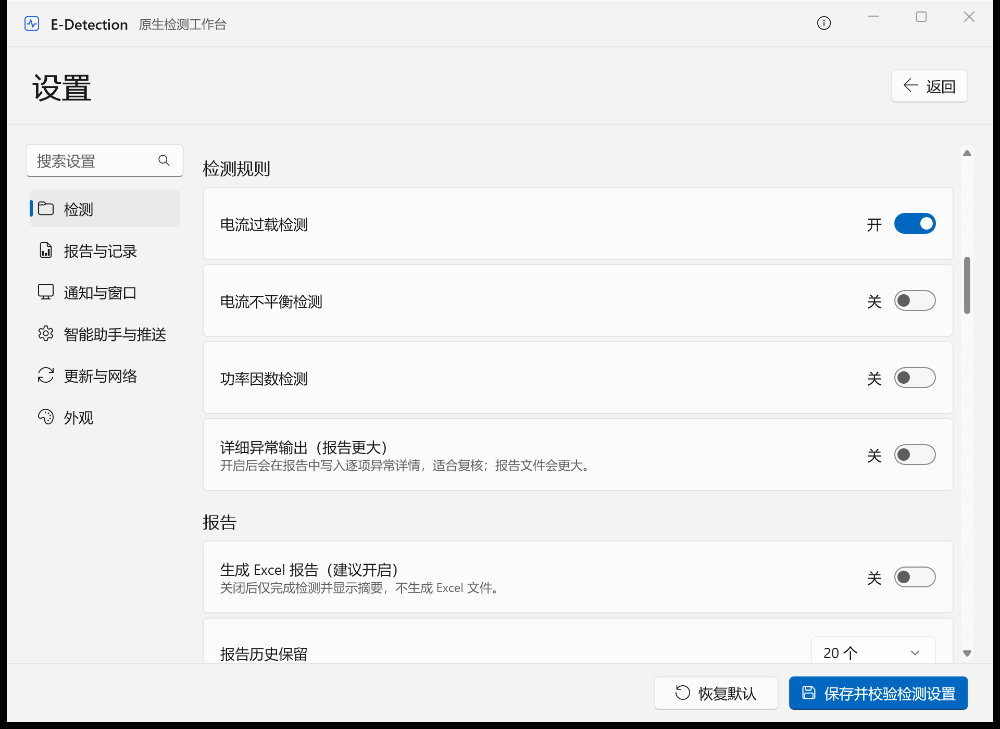

<p align="center">
  
</p>

<h1 align="center">E-Detection</h1>

<p align="center"><strong>Windows 原生电力数据异常检测工具</strong></p>

<p align="center">
  <a href="https://github.com/osGex0o0II/E-Detection/releases/latest">下载最新版本</a> ·
  <a href="#检测能力">检测能力</a> ·
  <a href="#使用方法">使用方法</a> ·
  <a href="docs/README.md">开发文档</a>
</p>

<p align="center"><code>C#</code> · <code>.NET 11</code> · <code>WinUI 3</code> · <code>Windows 10/11 x64</code></p>

批量读取电力监控与 SCADA 导出的 CSV 日报，识别异常测点和设备状态，并生成可追溯的 Excel 报告。检测、汇总和报告生成在本机完成。

## 检测能力

| 场景 | 检测内容 |
| --- | --- |
| 电压与接线 | 电压过低 / 过高、PT 接线异常、相电压不平衡 |
| 电流与功率 | 电流过大 / 不平衡、CT 极性、有功功率、功率因数 |
| 温度与数据质量 | 温度异常、数据冻结 / 恒定、设备离线、传感器故障或未配置 |
| 批量 CSV | 递归扫描目录；识别 UTF-8 BOM、UTF-8、GB18030、GBK；归一化常见测点列名 |
| 结果与报告 | 高风险设备、异常类型、异常明细、报告历史；按需导出包含 6 张工作表的 `.xlsx` |

核心处理不依赖 Python 运行时或外部进程桥接。可选的网络通知、更新检查和 AI 辅助功能与本地检测相互独立。

## 界面预览

以下为仓库保存的**真实软件截图（改版前）**，用于展示工作台布局。截图中的标题栏仍为旧版图标；工作台处于待命状态、计数为零，**不是本次新 Logo 的实机截图，也不代表已完成检测**。新版运行截图需在 Windows 上重新采集。


<details>
<summary>查看设置页面</summary>



</details>

## 使用方法

1. 前往 [GitHub Releases](https://github.com/osGex0o0II/E-Detection/releases/latest) 获取 Windows x64 安装包或便携包。
2. 启动软件，选择包含 CSV 日报的**输入目录**和**报告输出目录**。
3. 按需要调整检测规则和阈值；如需 Excel 文件，确保已开启“生成 Excel 报告”。
4. 点击**开始检测**，查看文件与异常统计、异常明细及报告历史。

报告包含**检测概览、异常明细、设备汇总、异常分类统计、传感器状态、检测配置** 6 张工作表。输入 CSV 仅被读取，检测过程不会覆盖原始文件。

> **发布提示**：目前 `v2.0.2` 发布物未签名，Windows 可能显示“未知发布者”或 SmartScreen 提示。请从仓库的官方 Release 页面获取文件；SHA-256 仅验证文件完整性，不能验证发布者身份。

## 开发与构建

开发环境：Windows 10/11 x64、.NET SDK 11.0.100、PowerShell 7；Windows App SDK 由 NuGet 还原。

```powershell
dotnet restore .\desktop\EDetection.Desktop.slnx
dotnet build .\desktop\EDetection.Desktop.slnx -c Debug --no-restore
dotnet test .\desktop\EDetection.Tests\EDetection.Tests.csproj -c Debug --no-build
dotnet run --project .\desktop\EDetection.Desktop\EDetection.Desktop.csproj -c Debug
```

默认检测规则位于 [`config.json`](config.json)。首次启动时会将默认配置复制到 `%LOCALAPPDATA%\E-Detection\Desktop\detection-config.json`。

更详细的依赖关系、CSV 与报告数据模型、测试命令及安装器构建流程放在开发文档中，避免重复维护：

- [文档导航](docs/README.md)：按目标查阅设计、架构、数据模型、状态和交接记录。
- [桌面开发指南](desktop/README.md)：运行、测试、打包、安装与排障。
- [视觉规范](docs/visual-guidelines.md)：Logo、配色、图标与截图展示约定。

## 致谢

项目使用 [.NET](https://dotnet.microsoft.com/)、[Windows App SDK / WinUI 3](https://github.com/microsoft/WindowsAppSDK)、[CommunityToolkit.Mvvm](https://github.com/CommunityToolkit/dotnet)、[WinUIEx](https://github.com/dotMorten/WinUIEx)、[xUnit](https://xunit.net/) 和 [Inno Setup](https://jrsoftware.org/isinfo.php)。

## 许可证

**尚未声明许可证**。仓库当前未包含 `LICENSE` 文件；公开可见不等于自动获得复制、修改或再分发许可。由仓库维护者确定许可证后，应同步更新这里与仓库设置。
